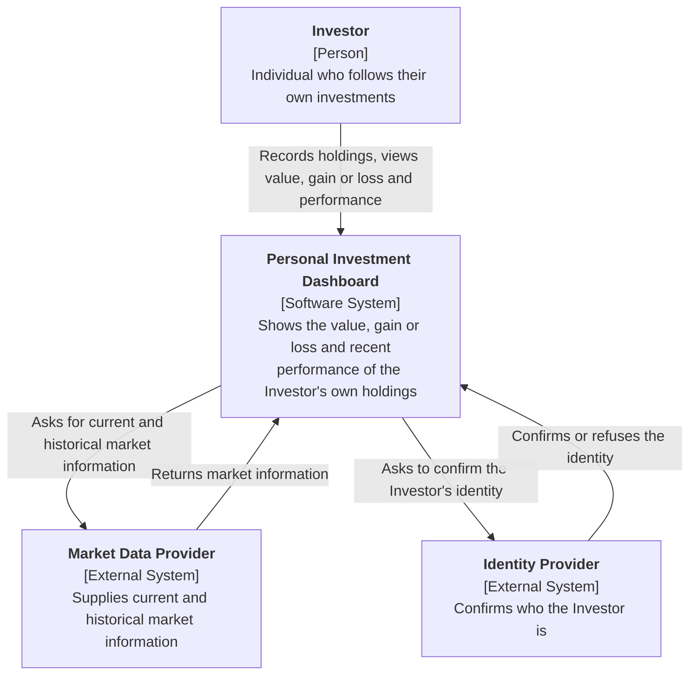

# Lab 1: Define the Initial Product

**Student:** <Nume Prenume>
**Group:** <Grupa>
**Client request:** "Help me follow my investments."

---

## 1. Product research

Research question: *How do existing products help a User follow market information, and which parts belong in this Dashboard's first version?*

Products examined (public pages and feature descriptions only, no account used):

- Market data product: **Google Finance** (https://www.google.com/finance/)
- Trading product: **TradingView** (https://www.tradingview.com/)

| Product | Likely User and goal | Reusable pattern |
|---|---|---|
| Google Finance | A private person who wants a quick view of how stocks, funds and markets are doing, and who keeps a personal list of tracked items. | **Watchlist and portfolio of tracked holdings** with current price and change since the previous close. Source: Google Finance public page (https://www.google.com/finance/). **Data freshness notice:** quotes may be delayed and the page says so. Source: Google Finance help/disclaimer text on the same site. |
| TradingView | A self-directed investor or trader who wants to follow price movements over time and compare periods. | **Price history over selectable periods** (day, month, year and so on). Source: TradingView features page (https://www.tradingview.com/features/). **Separation between following and trading:** order placement is done through connected brokers, not by TradingView itself. Source: TradingView broker integration page (https://www.tradingview.com/brokers/). |

**What the research changed or confirmed in scope:**

1. *Confirmed:* a personal list of holdings with current value and change is the core of the first version (Google Finance pattern).
2. *Confirmed:* the User must be told when market information is delayed or unavailable, so freshness is part of the first version.
3. *Changed:* I first considered including buying and selling. TradingView leaves order execution to brokers, so trading is removed from the first version (see non-goal N1).
4. *Confirmed:* history over selectable periods is useful, but advanced charting tools and drawing tools are not needed in the first version.

---

## 2. Stakeholders and actors

Method: UK Government stakeholder-mapping guide. Motivation and influence are rated High or Low, each with one reason.

| Stakeholder | Motivation | Influence | Reason |
|---|---|---|---|
| Individual investor (the User) | High | High | Uses the Dashboard daily to understand their own money, and their feedback decides what is kept or changed. |
| Course instructor / product owner | High | High | Accepts the product contract and decides whether the scope is correct. |
| Development team | High | Low | Must build and maintain the product but follows the agreed scope. |
| Market data provider | Low | High | Does not depend on this Dashboard, but its data availability and terms decide what results can be shown. |
| Identity provider | Low | High | Controls whether a User can prove who they are, and so whether private data stays private. |
| Financial regulator / data protection authority | Low | High | Rules on personal data and on what counts as investment advice can force changes to the product. |
| Stock exchanges and data licensors | Low | Low | Their licence terms affect the market data provider, only indirectly this product. |

**Stakeholder matrix**

| Motivation | Low influence | High influence |
|---|---|---|
| **High** | Development team | Individual investor (User); Course instructor / product owner |
| **Low** | Stock exchanges and data licensors | Market data provider; Identity provider; Financial regulator / data protection authority |

**Classification**

| Candidate | Classification | Reason |
|---|---|---|
| Individual investor (User) | Direct human actor | Interacts directly with the Dashboard. |
| Course instructor / product owner | Other stakeholder | Can change product decisions but does not use the Dashboard to follow investments. |
| Development team | Other stakeholder | Builds the product, does not use it as a User. |
| Market data provider | External system | Directly supplies market results to the Dashboard. |
| Identity provider | External system | Directly confirms the identity of the User for the Dashboard. |
| Financial regulator / data protection authority | Other stakeholder | Affects decisions but has no direct interaction with the Dashboard. |
| Stock exchanges and data licensors | Other stakeholder | Connected only through the market data provider, so not shown in the System Context view. |

Only the User, the Market data provider and the Identity provider are directly connected, so only these appear in the System Context view.

---

## 3. Product promise and scope

**Product promise**

> The Personal Investment Dashboard helps an individual investor follow the value and performance of their own investments so that they can see how their money is doing in one place without checking several sources.

**Goals**

| ID | Goal (User-visible result) |
|---|---|
| G1 | The User sees the current value of each of their holdings and of the whole portfolio. |
| G2 | The User sees the gain or loss of each holding and of the whole portfolio compared with what they paid. |
| G3 | The User sees how the value of a holding or of the portfolio changed over a chosen period. |
| G4 | The User always knows how recent the market information is, and is told clearly when it is delayed, missing or not supported. |
| G5 | The User's own list of holdings stays private to them and is still there on their next visit. |

**Non-goals**

| ID | Non-goal (work removed from the first version) |
|---|---|
| N1 | No buying or selling of investments and no order execution. |
| N2 | No automatic import of holdings from brokers or banks. The User enters their own holdings. |
| N3 | No investment advice, recommendations, forecasts or alerts. |

Consistency check: the promise is about *following* the value and performance of the User's own investments. G1 to G5 serve that promise, and N1 to N3 remove trading, automatic import and advice, which the promise does not include.

---

## 4. Functional requirements

### DASH-1: Record my holdings

**Actor goal:** The Investor needs to tell the Dashboard what they own and what they paid.

**User story:** As an Investor, I want to record the investments I own with quantity and purchase price, so that the Dashboard can follow them for me.

**Definitions of done:**
- A holding the User records appears in their list with the quantity and purchase price they gave.
- If the User gives an invalid quantity or price (empty, zero or negative), the holding is not saved and the User is told what to correct.
- If the investment name is not supported by the Dashboard, the User is told it cannot be followed and the list stays unchanged.

### DASH-2: See the current value of my portfolio

**Actor goal:** The Investor needs to learn how much their investments are worth now.

**User story:** As an Investor, I want to see the current value of each holding and of my whole portfolio, so that I know where I stand today.

**Definitions of done:**
- Each holding shows its current value and the total shows the sum of all holdings.
- Each value shows the time of the market information it is based on.
- If an empty portfolio is opened, the User is told they have no holdings yet and how to add one.

### DASH-3: See gain or loss

**Actor goal:** The Investor needs to learn whether they are making or losing money.

**User story:** As an Investor, I want to see the gain or loss of each holding and of my portfolio compared with what I paid, so that I understand how my investments are performing.

**Definitions of done:**
- Each holding and the total show the gain or loss as an amount and as a percentage.
- Gains and losses are visibly distinguishable.
- If the current value of a holding is unavailable, its gain or loss is shown as unavailable and is left out of the total, with a note saying so.

### DASH-4: Review performance over a period

**Actor goal:** The Investor needs to learn how their investments changed over time.

**User story:** As an Investor, I want to choose a period such as a day, a month or a year and see how a holding or my portfolio changed in it, so that I can understand trends in my own investments.

**Definitions of done:**
- After choosing a period, the User sees the change in value for that period for the selected holding or the portfolio.
- If no information exists for the whole period (for example a recently listed investment), the User sees the change for the available part and is told it is shorter than requested.
- If the period is not supported, the User is told which periods are available.

### DASH-5: Know how fresh and reliable the information is

**Actor goal:** The Investor needs to know whether they can trust what they see.

**User story:** As an Investor, I want to be told when market information is delayed, missing or unsupported, so that I do not make decisions based on wrong numbers.

**Definitions of done:**
- Delayed information is marked as delayed and shows the time it refers to.
- If market information is missing for a holding, that holding is marked as unavailable and the rest of the portfolio is still shown.
- If market information is unavailable for all holdings, the User sees a clear message that nothing can be updated now and the last known values are labelled as old.
- Unsupported investments are marked as unsupported and not included in totals.

### DASH-6: Keep my portfolio private

**Actor goal:** The Investor needs their financial information to be visible only to them.

**User story:** As an Investor, I want to sign in to see my portfolio, so that my holdings stay private and are still there next time I visit.

**Definitions of done:**
- After signing in, the User sees only their own holdings, including those entered in earlier visits.
- Without signing in, the User sees no holdings or portfolio values and is asked to sign in.
- If sign-in fails or the identity cannot be confirmed, access is refused and no holdings are shown.
- If another person's holdings are requested, access is refused.

**Flow coverage:** DASH-1 (enter data), DASH-2 and DASH-3 (current state), DASH-4 (history), DASH-5 (missing / stale / unsupported results), DASH-6 (access and privacy). DASH-1, DASH-4, DASH-5 and DASH-6 include a missing, stale, unsupported or unauthorized check.

---

## 5. C4 System Context view

Elements: the Personal Investment Dashboard is in the center, the only direct human actor is the Investor, and the two directly connected external systems are the Market Data Provider and the Identity Provider. No applications, APIs, databases, caches, queues, services or cloud products are shown inside the Dashboard.

**External system checks**

| External system | Dashboard responsibility that needs it | Result it supplies | What the User sees when the result is missing, stale or unsupported |
|---|---|---|---|
| Market Data Provider | Showing current value, gain or loss and performance over a period (DASH-2, DASH-3, DASH-4, DASH-5). | Current and historical market information for the investments the User holds. | **Missing:** the holding is marked "unavailable" and left out of totals, other holdings are still shown. **Stale:** the value is marked "delayed" with the time it refers to. **Unsupported:** the investment is marked "not supported" and not included in totals. |
| Identity Provider | Keeping each User's portfolio private (DASH-6). | Confirmation of who the User is. | **Missing:** the User sees that sign-in is not possible now and no holdings are shown. **Stale:** an expired confirmation asks the User to sign in again. **Unsupported:** an unrecognized identity is refused with a clear message and no holdings are shown. |

The external system owns its source result (market information, identity confirmation). The Dashboard still owns how that result becomes clear and safe for the User: labelling delays, isolating missing items and refusing access when identity is not confirmed.

---

## Checklist

- [x] I researched at least two existing products.
- [x] I cited evidence for each selected product pattern.
- [x] My research changed or confirmed at least one scope decision.
- [x] I mapped stakeholder motivation and influence.
- [x] I separated stakeholders, direct human actors, and external systems.
- [x] My product promise is one clear sentence.
- [x] My goals and non-goals agree with my product promise.
- [x] I wrote at least five user stories.
- [x] Every story has two to four definitions of done.
- [x] At least two stories include an important alternative result.
- [x] My external dependencies include a User-visible missing, stale, or unsupported result.
- [x] I created a C4 System Context view of the Dashboard.
