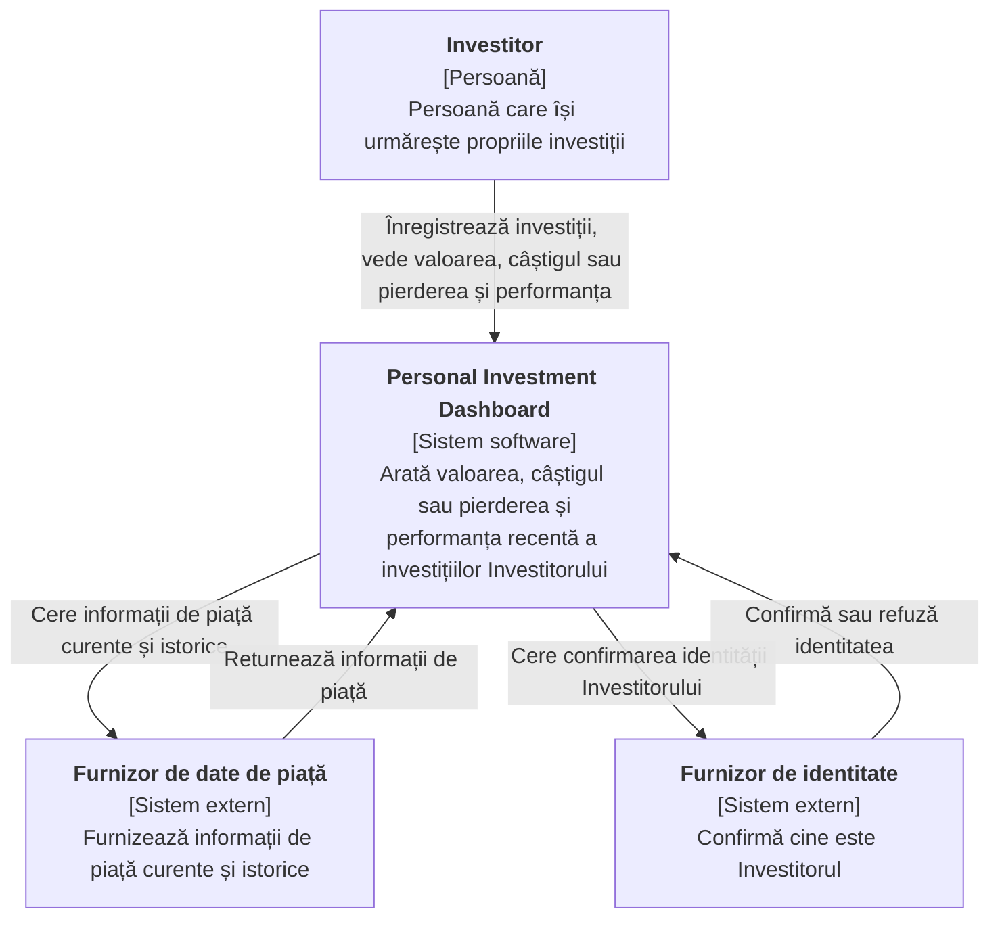

# Laborator 1: Definirea produsului inițial

**Student:    Reul Alexei **
**Grupa: Infa-241**
**Cererea clientului:** „Ajută-mă să-mi urmăresc investițiile."

---

## Cuprins

1. [Cercetarea produselor](#1-cercetarea-produselor)
2. [Părți interesate și actori](#2-părți-interesate-și-actori)
3. [Promisiunea produsului și scopul](#3-promisiunea-produsului-și-scopul)
4. [Cerințe funcționale](#4-cerințe-funcționale)
5. [Vizualizarea C4 System Context](#5-vizualizarea-c4-system-context)
6. [Lista de verificare](#lista-de-verificare)

---

## 1. Cercetarea produselor

**Întrebarea de cercetare:** *Cum ajută produsele existente un utilizator să urmărească informațiile de piață și care dintre aceste părți aparțin primei versiuni a Dashboard-ului?*

**Produse analizate** (doar pagini publice și descrieri de funcții, fără cont):

| Tip | Produs | Sursă |
|---|---|---|
| Produs de date de piață | Google Finance | https://www.google.com/finance/ |
| Produs de tranzacționare | TradingView | https://www.tradingview.com/ |

### Tabel de cercetare

| Produs | Utilizator probabil și scop | Șablon reutilizabil |
|---|---|---|
| Google Finance | O persoană privată care vrea o privire rapidă asupra acțiunilor, fondurilor și piețelor și care își păstrează o listă personală de elemente urmărite. | **Listă de urmărire și portofoliu** cu prețul curent și variația față de închiderea anterioară (sursă: pagina publică Google Finance). **Notă despre actualitatea datelor:** cotațiile pot fi întârziate, iar pagina o precizează (sursă: textul de informare de pe același site). |
| TradingView | Un investitor sau trader independent care vrea să urmărească evoluția prețurilor în timp și să compare perioade. | **Istoric de preț pe perioade selectabile** (zi, lună, an etc.) (sursă: https://www.tradingview.com/features/). **Separarea între urmărire și tranzacționare:** ordinele se plasează prin brokeri conectați, nu direct în TradingView (sursă: https://www.tradingview.com/brokers/). |

### Ce a schimbat sau confirmat cercetarea în scop

| Nr. | Decizie | Motiv |
|---|---|---|
| 1 | **Confirmat:** lista personală de investiții cu valoare curentă și variație este nucleul primei versiuni. | Șablonul „listă de urmărire" din Google Finance. |
| 2 | **Confirmat:** utilizatorul trebuie informat când datele sunt întârziate sau indisponibile. | Notele despre întârziere din Google Finance. |
| 3 | **Schimbat:** cumpărarea și vânzarea au fost scoase din prima versiune. | TradingView lasă execuția ordinelor în seama brokerilor (vezi non-obiectivul N1). |
| 4 | **Confirmat:** istoricul pe perioade este util, dar uneltele avansate de grafice nu sunt necesare. | Funcțiile TradingView depășesc nevoia unei prime versiuni. |

---

## 2. Părți interesate și actori

**Metodă:** ghidul UK Government de cartografiere a părților interesate. Motivația și influența sunt notate *Mare* sau *Mică*, fiecare cu un motiv.

### Tabel părți interesate

| Parte interesată | Motivație | Influență | Motiv |
|---|---|---|---|
| Investitor individual (Utilizatorul) | Mare | Mare | Folosește Dashboard-ul zilnic pentru a-și înțelege banii, iar feedbackul lui decide ce se păstrează sau se schimbă. |
| Profesor / proprietar de produs | Mare | Mare | Acceptă contractul de produs și decide dacă scopul este corect. |
| Echipa de dezvoltare | Mare | Mică | Construiește și întreține produsul, dar urmează scopul stabilit. |
| Furnizor de date de piață | Mică | Mare | Nu depinde de acest Dashboard, dar disponibilitatea și condițiile datelor sale decid ce se poate afișa. |
| Furnizor de identitate | Mică | Mare | Controlează dacă un utilizator își poate dovedi identitatea, deci dacă datele private rămân private. |
| Autoritate de reglementare / protecția datelor | Mică | Mare | Regulile privind datele personale și sfaturile de investiții pot impune schimbări produsului. |
| Burse și deținători de licențe de date | Mică | Mică | Condițiile lor de licențiere afectează doar indirect produsul, prin furnizorul de date. |

### Matricea părților interesate

| Motivație | Influență mică | Influență mare |
|---|---|---|
| **Mare** | Echipa de dezvoltare | Investitor individual (Utilizator); Profesor / proprietar de produs |
| **Mică** | Burse și deținători de licențe de date | Furnizor de date de piață; Furnizor de identitate; Autoritate de reglementare / protecția datelor |

### Clasificare

| Candidat | Clasificare | Motiv |
|---|---|---|
| Investitor individual (Utilizator) | **Actor uman direct** | Interacționează direct cu Dashboard-ul. |
| Profesor / proprietar de produs | Altă parte interesată | Poate schimba decizii de produs, dar nu folosește Dashboard-ul ca utilizator. |
| Echipa de dezvoltare | Altă parte interesată | Construiește produsul, nu îl folosește ca utilizator. |
| Furnizor de date de piață | **Sistem extern** | Furnizează direct rezultate de piață Dashboard-ului. |
| Furnizor de identitate | **Sistem extern** | Confirmă direct identitatea utilizatorului pentru Dashboard. |
| Autoritate de reglementare / protecția datelor | Altă parte interesată | Influențează deciziile, dar nu interacționează direct cu Dashboard-ul. |
| Burse și deținători de licențe de date | Altă parte interesată | Conectate doar prin furnizorul de date, deci nu apar în vizualizarea System Context. |

> **Regulă folosită:** o *parte interesată* este afectată de produs sau poate schimba o decizie de produs. Un *actor* sau *sistem extern* interacționează direct cu Dashboard-ul. În vizualizarea System Context apar doar actorii și sistemele conectate direct: Utilizatorul, Furnizorul de date de piață și Furnizorul de identitate.

---

## 3. Promisiunea produsului și scopul

### Promisiunea produsului

> Personal Investment Dashboard ajută un investitor individual să urmărească valoarea și performanța propriilor investiții, astfel încât să vadă într-un singur loc cum îi merg banii, fără să verifice mai multe surse.

### Obiective (cinci)

| ID | Obiectiv (rezultat vizibil pentru utilizator) |
|---|---|
| G1 | Utilizatorul vede valoarea curentă a fiecărei investiții și a întregului portofoliu. |
| G2 | Utilizatorul vede câștigul sau pierderea fiecărei investiții și a întregului portofoliu față de suma plătită. |
| G3 | Utilizatorul vede cum s-a schimbat valoarea unei investiții sau a portofoliului într-o perioadă aleasă. |
| G4 | Utilizatorul știe mereu cât de recente sunt informațiile de piață și este anunțat clar când sunt întârziate, lipsă sau nesuportate. |
| G5 | Lista personală de investiții rămâne privată și este disponibilă la următoarea vizită. |

### Non-obiective (trei)

| ID | Non-obiectiv (muncă eliminată din prima versiune) |
|---|---|
| N1 | Fără cumpărare sau vânzare de investiții și fără execuția ordinelor. |
| N2 | Fără import automat al investițiilor de la brokeri sau bănci. Utilizatorul își introduce singur investițiile. |
| N3 | Fără sfaturi de investiții, recomandări, previziuni sau alerte. |

**Verificare de coerență:** promisiunea vorbește despre *urmărirea* valorii și performanței investițiilor proprii. G1–G5 servesc această promisiune, iar N1–N3 elimină tranzacționarea, importul automat și sfaturile, care nu fac parte din promisiune.

---

## 4. Cerințe funcționale

### Pașii folosiți pentru fiecare poveste

1. **Scopul actorului:** ce trebuie să realizeze sau să afle actorul.
2. **Povestea utilizatorului:** *În calitate de ‹actor›, vreau ‹scop›, astfel încât ‹rezultat util›.*
3. **Definiții de „terminat":** 2–4 verificări observabile.

### DASH-1: Înregistrarea investițiilor mele

- **Scopul actorului:** Investitorul trebuie să comunice Dashboard-ului ce deține și cât a plătit.
- **Povestea:** În calitate de Investitor, vreau să înregistrez investițiile pe care le dețin, cu cantitate și preț de achiziție, astfel încât Dashboard-ul să le poată urmări pentru mine.
- **Definiții de „terminat":**
  - O investiție înregistrată apare în listă cu cantitatea și prețul introduse.
  - Dacă cantitatea sau prețul sunt invalide (gol, zero sau negativ), investiția nu se salvează și utilizatorul este informat ce să corecteze.
  - Dacă numele investiției nu este suportat, utilizatorul este anunțat că nu poate fi urmărită, iar lista rămâne neschimbată.

### DASH-2: Vizualizarea valorii curente a portofoliului

- **Scopul actorului:** Investitorul trebuie să afle cât valorează acum investițiile lui.
- **Povestea:** În calitate de Investitor, vreau să văd valoarea curentă a fiecărei investiții și a întregului portofoliu, astfel încât să știu unde mă aflu astăzi.
- **Definiții de „terminat":**
  - Fiecare investiție afișează valoarea curentă, iar totalul arată suma tuturor.
  - Fiecare valoare arată momentul informației de piață pe care se bazează.
  - Dacă portofoliul este gol, utilizatorul este informat că nu are investiții și cum să adauge una.

### DASH-3: Vizualizarea câștigului sau pierderii

- **Scopul actorului:** Investitorul trebuie să afle dacă câștigă sau pierde bani.
- **Povestea:** În calitate de Investitor, vreau să văd câștigul sau pierderea fiecărei investiții și a portofoliului față de ce am plătit, astfel încât să înțeleg cum se comportă investițiile mele.
- **Definiții de „terminat":**
  - Fiecare investiție și totalul arată câștigul sau pierderea ca sumă și ca procent.
  - Câștigurile și pierderile se disting vizibil.
  - Dacă valoarea curentă a unei investiții este indisponibilă, câștigul/pierderea ei apare ca indisponibil(ă) și este exclus(ă) din total, cu o notă explicativă.

### DASH-4: Analiza performanței pe o perioadă

- **Scopul actorului:** Investitorul trebuie să afle cum s-au schimbat investițiile în timp.
- **Povestea:** În calitate de Investitor, vreau să aleg o perioadă (zi, lună, an) și să văd cum s-a schimbat o investiție sau portofoliul meu în ea, astfel încât să înțeleg tendințele propriilor investiții.
- **Definiții de „terminat":**
  - După alegerea unei perioade, utilizatorul vede variația valorii pentru acea perioadă, pentru investiția aleasă sau pentru portofoliu.
  - Dacă nu există informații pentru toată perioada (de exemplu o investiție listată recent), utilizatorul vede variația pe partea disponibilă și este anunțat că perioada este mai scurtă decât cea cerută.
  - Dacă perioada nu este suportată, utilizatorul este informat ce perioade sunt disponibile.

### DASH-5: Aflarea cât de actuale și de fiabile sunt informațiile

- **Scopul actorului:** Investitorul trebuie să știe dacă poate avea încredere în ce vede.
- **Povestea:** În calitate de Investitor, vreau să fiu anunțat când informațiile de piață sunt întârziate, lipsă sau nesuportate, astfel încât să nu iau decizii pe baza unor cifre greșite.
- **Definiții de „terminat":**
  - Informația întârziată este marcată ca atare și arată momentul la care se referă.
  - Dacă informația lipsește pentru o investiție, aceasta este marcată „indisponibil", iar restul portofoliului se afișează în continuare.
  - Dacă informația lipsește pentru toate investițiile, utilizatorul vede un mesaj clar că nimic nu se poate actualiza acum, iar ultimele valori cunoscute sunt etichetate ca vechi.
  - Investițiile nesuportate sunt marcate „nesuportat" și nu intră în totaluri.

### DASH-6: Păstrarea portofoliului privat

- **Scopul actorului:** Investitorul trebuie ca informațiile lui financiare să fie vizibile doar pentru el.
- **Povestea:** În calitate de Investitor, vreau să mă autentific pentru a-mi vedea portofoliul, astfel încât investițiile mele să rămână private și să fie acolo la următoarea vizită.
- **Definiții de „terminat":**
  - După autentificare, utilizatorul vede doar investițiile lui, inclusiv pe cele introduse în vizite anterioare.
  - Fără autentificare, utilizatorul nu vede nicio investiție sau valoare și este rugat să se autentifice.
  - Dacă autentificarea eșuează sau identitatea nu poate fi confirmată, accesul este refuzat și nu se afișează nicio investiție.
  - Dacă se cer investițiile altei persoane, accesul este refuzat.

### Acoperirea fluxurilor importante

| Poveste | Flux acoperit | Rezultat alternativ important |
|---|---|---|
| DASH-1 | Introducerea datelor | Date invalide sau nesuportate |
| DASH-2 | Starea curentă | Portofoliu gol |
| DASH-3 | Câștig / pierdere | Valoare indisponibilă |
| DASH-4 | Istoric pe perioadă | Istoric incomplet sau perioadă nesuportată |
| DASH-5 | Actualitatea datelor | **Lipsă / întârziat / nesuportat** |
| DASH-6 | Acces și confidențialitate | **Neautorizat** |

---

## 5. Vizualizarea C4 System Context

**Elemente:**

- În centru: Personal Investment Dashboard.
- Singurul actor uman direct: Investitorul.
- Sisteme externe conectate direct: Furnizorul de date de piață și Furnizorul de identitate.
- În interiorul Dashboard-ului nu sunt afișate aplicații, API-uri, baze de date, cache-uri, cozi, servicii sau produse cloud.

### Verificarea sistemelor externe

| Sistem extern | Responsabilitatea Dashboard-ului care îl necesită | Rezultatul pe care îl furnizează | Ce vede utilizatorul când rezultatul lipsește, e depășit sau nesuportat |
|---|---|---|---|
| Furnizor de date de piață | Afișarea valorii curente, câștigului/pierderii și performanței pe perioadă (DASH-2, 3, 4, 5). | Informații de piață curente și istorice pentru investițiile deținute. | **Lipsă:** investiția e marcată „indisponibil" și exclusă din totaluri, restul se afișează. **Depășit:** valoarea e marcată „întârziat" cu momentul la care se referă. **Nesuportat:** investiția e marcată „nesuportat" și exclusă din totaluri. |
| Furnizor de identitate | Păstrarea privată a portofoliului fiecărui utilizator (DASH-6). | Confirmarea identității utilizatorului. | **Lipsă:** utilizatorul vede că autentificarea nu e posibilă acum și nu se afișează nicio investiție. **Depășit:** o confirmare expirată cere reautentificare. **Nesuportat:** o identitate nerecunoscută este refuzată cu mesaj clar și fără investiții afișate. |

> **Principiu:** sistemul extern deține rezultatul sursă (informații de piață, confirmarea identității). Dashboard-ul deține în continuare modul în care acel rezultat devine clar și sigur pentru utilizator: etichetarea întârzierilor, izolarea elementelor lipsă și refuzul accesului când identitatea nu e confirmată.

---