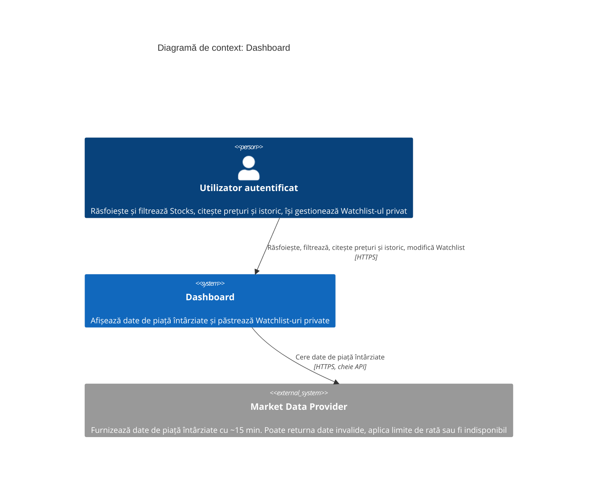
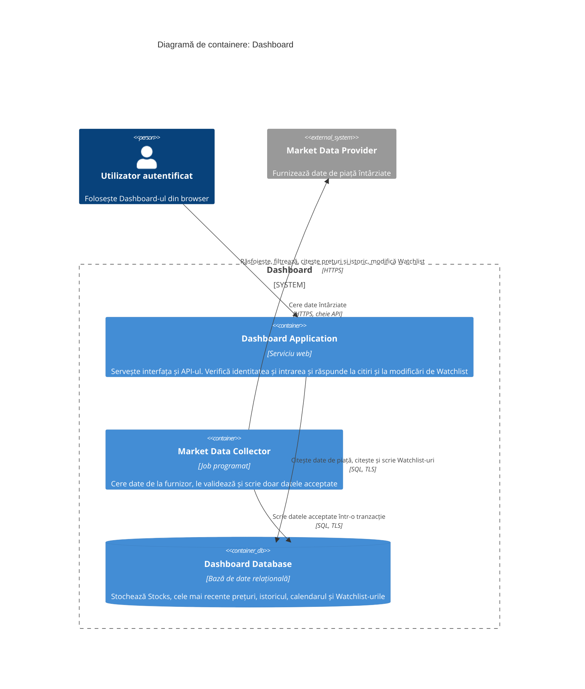
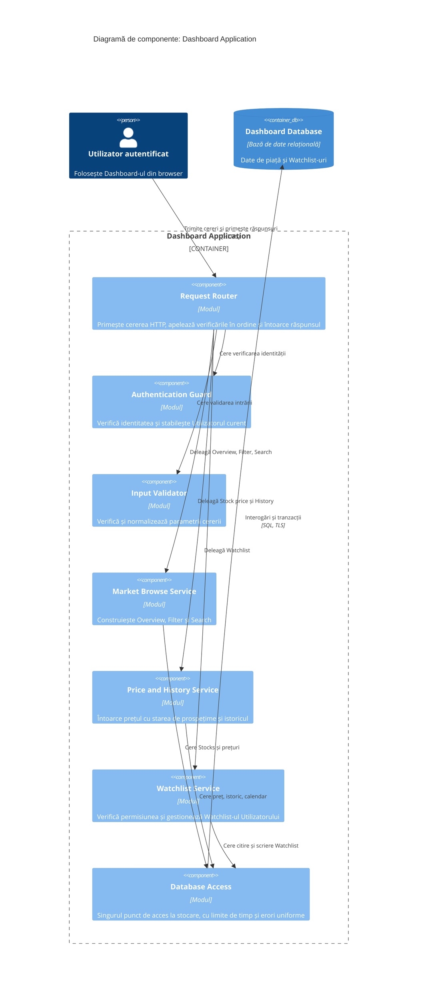
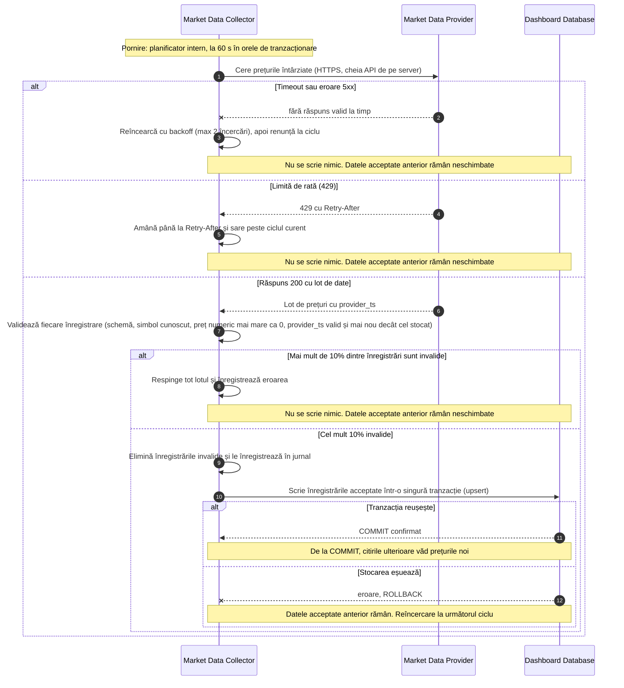
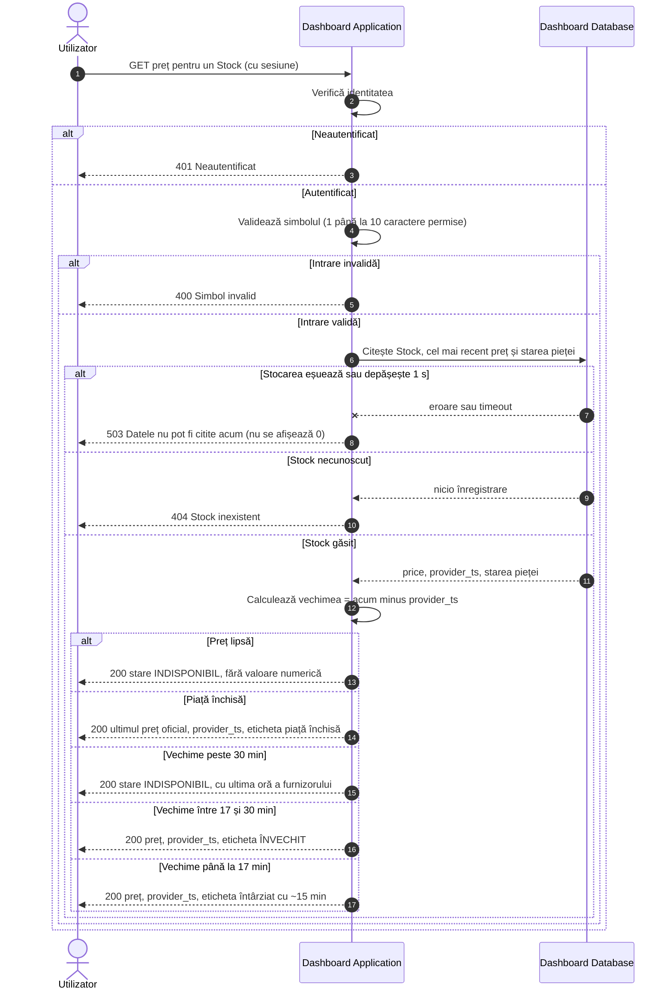
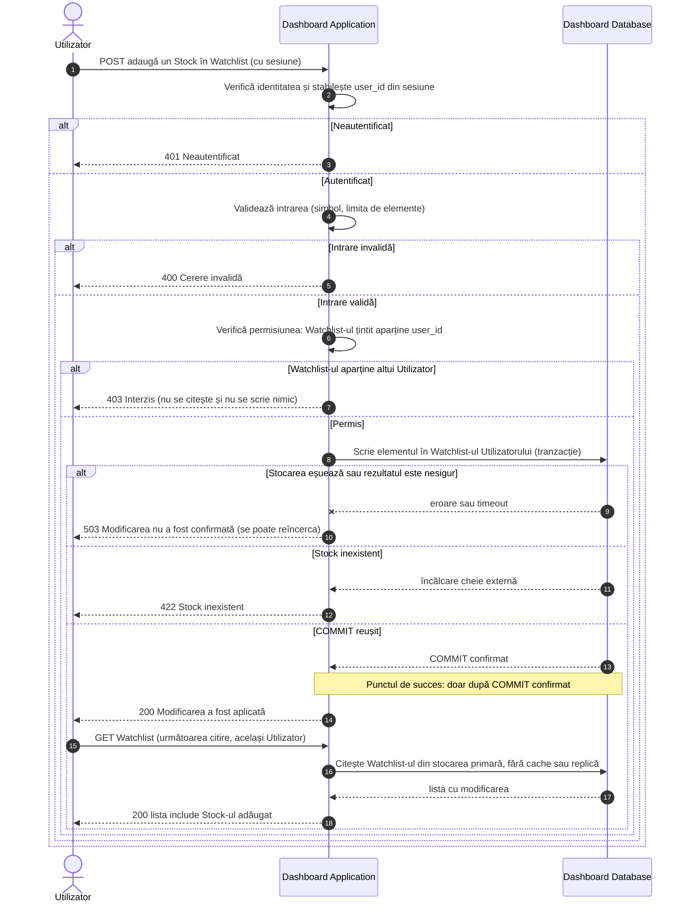

# Laboratorul 3: Desenează limita Dashboard-ului

**Student:** Reul Alexei · **Grupa:** Infa-241 · **Data:** 13 octombrie 2026

## 0. Puncte de pornire și presupuneri generale

- Aceleași ținte de încărcare ca în Laboratorul 2: 103 / 1,030 / 10,296 RPS la deschiderea pieței pentru 300 / 3,000 / 30,000 de Utilizatori concurenți, cu p95 ≤ 2,000 ms (Stock price: p95 ≤ 500 ms).
- Aceleași reguli de prospețime (C1 din Laboratorul 2): un preț are vechimea = momentul răspunsului minus ora furnizorului; până la 17 min este acceptat, între 17 și 30 min este marcat „învechit”, peste 30 min sau lipsă este „indisponibil” (niciodată 0).
- Citirea unui Watchlist după o modificare confirmată trebuie să arate modificarea (C4 din Laboratorul 2); Watchlist-ul unui Utilizator nu poate fi citit sau modificat de altcineva.
- Utilizatorul este deja autentificat prin sesiune (token semnat, verificat de Dashboard Application). Înregistrarea și autentificarea inițială sunt în afara acestui laborator.
- Citirile Utilizatorului nu creează cereri către furnizor: Dashboard-ul sincronizează datele în propria stocare, iar citirile se fac din ea (la fel ca în secțiunea 4 din Laboratorul 2).
- Numele elementelor (Dashboard Application, Market Data Collector, Dashboard Database, Market Data Provider) rămân identice în toate cele șase diagrame. Diagramele au fost verificate sintactic cu parserul Mermaid.

## 1. Diagrama de context

**Ce arată:** limita sistemului (Dashboard, tratat ca o singură cutie), un actor uman (Utilizatorul autentificat) și un sistem extern (Market Data Provider), cu relații etichetate. Nu apar părți interne. Utilizatorul nu comunică niciodată direct cu furnizorul.

## 2. Diagrama de containere

| Container | Responsabilitate unică | Comunică direct cu |
| --- | --- | --- |
| Dashboard Application | Răspunde Utilizatorului: verifică identitatea și intrarea, apoi citește date sau modifică Watchlist-ul | Utilizator (HTTPS), Dashboard Database (SQL) |
| Market Data Collector | Aduce date de la furnizor și le face disponibile doar după validare | Market Data Provider (HTTPS), Dashboard Database (SQL) |
| Dashboard Database | Păstrează datele de piață acceptate și Watchlist-urile | Dashboard Application, Market Data Collector |

**De ce acest set minim:**

- **Market Data Collector separat de Dashboard Application.** Furnizorul poate fi lent, poate aplica limite de rată sau poate cădea (blocaj de disponibilitate din Laboratorul 2). Dacă apelul către furnizor ar fi în calea citirii, o problemă a furnizorului ar deveni o problemă a Dashboard-ului. Separarea păstrează și cheia API într-un singur loc, pe server, fără acces din browser sau din Dashboard Application.
- **O singură Dashboard Database.** Citirile Watchlist merg la stocarea primară, deci citirea după scriere (C4) este simplă de garantat. Volumul brut estimat este 2.41 GB inițial (Laboratorul 2), ceea ce nu cere împărțirea datelor în mai multe stocări.
- **Fără cache separat, coadă sau serviciu de autentificare.** Căile cu RPS mare (Stock price 6,000 RPS, Overview 1,600 RPS la deschidere pentru 30,000 de Utilizatori) sunt doar ipoteze de blocaj. Un cache se adaugă numai dacă testul de încărcare dovedește că este necesar. Sesiunile sunt tokenuri semnate, verificate în aplicație.
- **Fără container pentru interfață.** Dashboard Application servește și interfața web.

| Cerință din Laboratorul 2 | Cum este acoperită de design |
| --- | --- |
| Latență (L1–L3) | Toate citirile merg într-un singur salt către Dashboard Database, fără apel către furnizor |
| Disponibilitate | Căderea furnizorului afectează doar Market Data Collector; citirile continuă cu date existente, marcate „învechit” sau „indisponibil” |
| Consistență (C1, C3) | Collector scrie doar date validate; Dashboard Application calculează vechimea la fiecare citire |
| Consistență (C4, C5) | Watchlist se scrie și se citește din stocarea primară, cu identitatea luată din sesiune |
| Debit (T1, T2) | Dashboard Application poate fi rulat în mai multe instanțe în fața aceleiași stocări; limita reală se măsoară |

## 3. Diagrama de componente (Dashboard Application)

| Componentă | Responsabilitate | Elemente care comunică direct cu ea |
| --- | --- | --- |
| Request Router | Punctul de intrare HTTP: ordinea verificărilor (identitate, intrare, serviciu) și maparea rezultatului în cod HTTP | Utilizator (HTTPS), Authentication Guard, Input Validator, cele trei servicii |
| Authentication Guard | Verifică sesiunea și furnizează user\_id; nu acceptă user\_id din cerere | Request Router |
| Input Validator | Respinge simboluri, filtre și parametri invalizi înainte de orice acces la stocare | Request Router |
| Market Browse Service | Overview, Filter și Search peste Stocks și cele mai recente prețuri | Request Router, Database Access |
| Price and History Service | Stock price și History; clasifică vechimea (până la 17 min, 17–30 min, peste 30 min sau lipsă, piață închisă) | Request Router, Database Access |
| Watchlist Service | Verifică dacă Watchlist-ul aparține Utilizatorului curent și aplică adăugarea, eliminarea și citirea | Request Router, Database Access |
| Database Access | Conexiuni, limite de timp (1 s) și transformarea erorilor de stocare într-un rezultat uniform | Cele trei servicii, Dashboard Database |

**Ce nu este arătat:** doar Dashboard Application este deschis; Dashboard Database apare ca element extern. Market Data Collector și Market Data Provider nu comunică direct cu nicio componentă: singura legătură dintre ele și Dashboard Application sunt datele din Dashboard Database. Nu sunt arătate clase, funcții sau aplicații desfășurate separat.

## 4. Diagrame de secvență

### A. Sincronizarea datelor de piață

**Presupuneri de pornire:**

- Sincronizarea este pornită de planificatorul intern al lui Market Data Collector, la fiecare 60 s între 09:00 și 16:30 ET (prețuri recente); datele de referință și istoricul rulează după programul din Laboratorul 2. Nu o pornește nicio cerere a Utilizatorului.
- Cheia API a furnizorului este în configurația de pe server, accesibilă doar lui Market Data Collector; nu ajunge în browser, în răspunsuri sau în jurnale.
- Pragul de 10% (lot suspect) și cele 2 reîncercări sunt presupuneri de proiectare, de ajustat după măsurători.

**Ce se întâmplă cu datele acceptate anterior când sincronizarea eșuează:** rămân neschimbate (nu se șterg și nu se suprascriu). Datele devin vizibile pentru citiri doar după COMMIT, deci nu apar niciodată date parțiale. Cât timp sincronizarea eșuează, vechimea prețurilor crește și Diagrama B le marchează „învechit” după 17 min și „indisponibil” după 30 min.

### B. Citirea unui Stock price

**Presupuneri de pornire:**

- **O citire a Utilizatorului nu cere nicio dată nouă furnizorului.** Prețul vine din Dashboard Database, scris anterior de Market Data Collector (Diagrama A). Market Data Provider nu apare în această diagramă.
- Limitele de vechime sunt cele din Laboratorul 2: 17 min acceptat, 30 min indisponibil; în afara orelor de tranzacționare se aplică ultimul preț oficial cu eticheta „piață închisă”.
- Limita de timp la stocare este de 1 s (presupunere); un 503 este rezultat de eroare și se numără la rata erorilor și la disponibilitate. Un rezultat „indisponibil” (200, marcat) este alt tip de rezultat și se măsoară separat (C2).

### C. Modificarea unui Watchlist privat

**Presupuneri de pornire:**

- user\_id vine din sesiune, nu din corpul sau adresa cererii; Watchlist-ul țintit este cel al lui user\_id. Dacă cererea indică Watchlist-ul altcuiva, rezultatul este 403 și nu se atinge stocarea (se poate returna și 404 pentru a nu dezvălui existența, am ales 403 pentru claritate).
- Adăugarea este idempotentă (același Stock adăugat de două ori produce aceeași listă), deci o reîncercare după un 503 este sigură. Limita de elemente (de exemplu 100) este o presupunere.
- **Succesul se raportează doar după COMMIT confirmat.** Dacă rezultatul scrierii este nesigur (timeout), Utilizatorul primește 503, nu succes.
- **Următoarea citire a Watchlist-ului de către același Utilizator trebuie să arate modificarea (100%, C4)**: citirea se face din stocarea primară, fără cache sau replică întârziată, din orice sesiune a aceluiași Utilizator.

